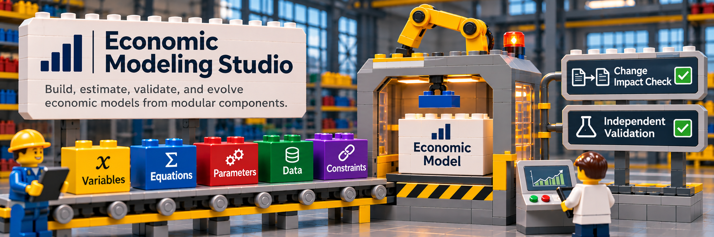
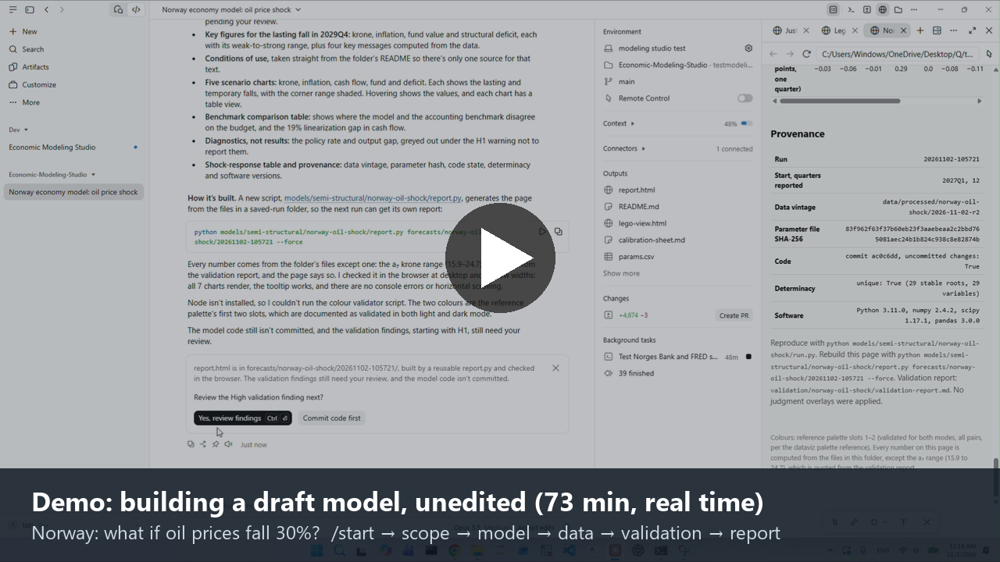
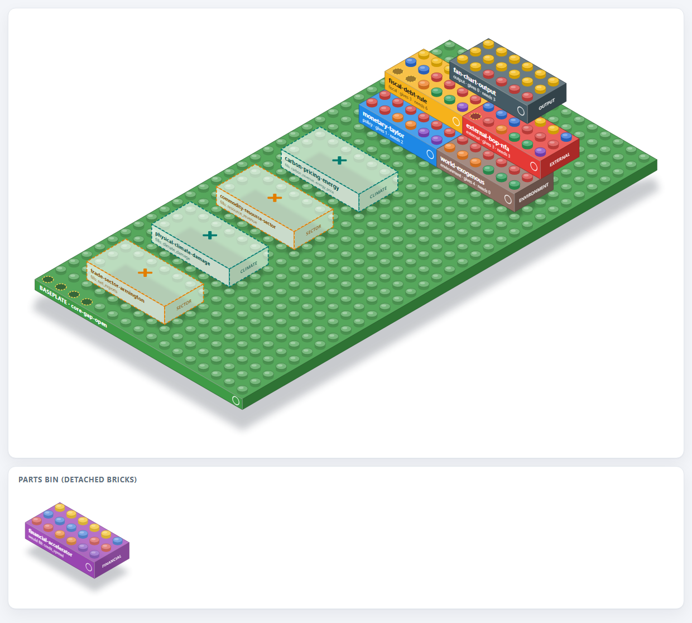
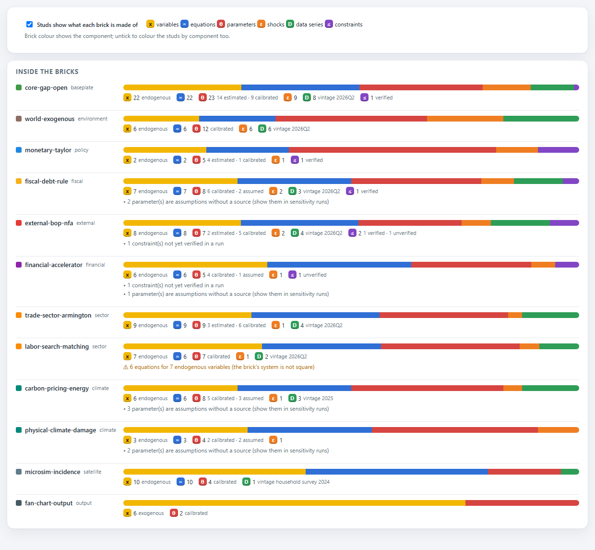
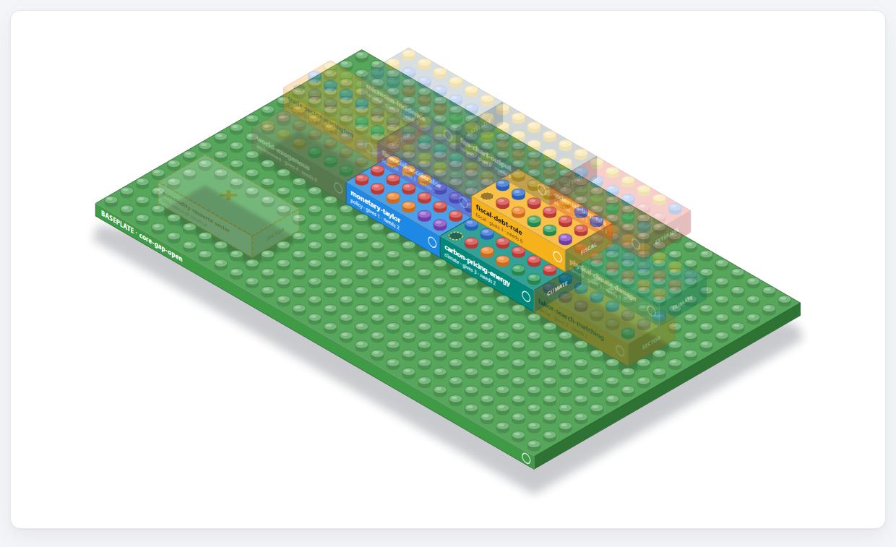

# Economic Modeling Studio

**Version 3.3.0**

A studio for building, estimating, validating and using economic models. **127 specialist agents** and **94 skills** (workflow commands such as `/build-dsge` or `/validate-model`) cover specification, building, estimation and independent validation for semi-structural projection and DSGE, input-output and CGE, trade and climate-economy models, deep learning, reinforcement learning, neural-network solvers, LLM-based tools, agent-based and game-theoretic models, and other econometric models. The studio also lets you work with every model as a **lego set**: a core model with plug-and-play components that can be added, swapped or removed, with explicit interfaces and the impact of every change checked first. It also **translates model code** between the languages and software economists use (Stata, R, Python, MATLAB, Dynare, EViews, SAS, GAMS, Fortran, COBOL and more), and tests the translation against the original's outputs. It works with any coding agent that reads `AGENTS.md`: Claude Code, Codex, Cursor, Grok Build, Gemini CLI and others.

> The repository contains the studio (agents, commands, rules, templates and guardrails), not a library of finished models. Models are built in your own copy.

**From version 3.0 the studio and its agents can be used by outside agents as well as by people.** An outside agent can be any AI agent or system of agents, built on any model or framework and run by you or by others. It can use the studio's tools, run its skills, and call on its 127 specialist agents, taking on a specialist's instructions for a task:
- **Agents use their own language.** Agents do not need the prose and reports people read. They talk to the studio in short JSON messages, with numbered findings and ready-made fixes. One call teaches an agent the whole language, and any message can be turned back into plain language for a person.
- **Any MCP client, and hundreds of MCP servers.** The studio is an MCP server for any tool that speaks the Model Context Protocol (Claude Code, Cursor, VS Code with Copilot, Gemini CLI, Codex and others), and a gateway connects one agent to hundreds of MCP servers at once.
- **Hundreds of agents in parallel.** Agents work on the same model at the same time in a shared workspace, and no agent's change is ever lost or silently overwritten. One command runs a swarm of 100 agents calibrating an economy.
- **Recursive self-improvement modeling (RSIM).** Agents improve models by themselves, round after round, each round starting from the best model so far. Agents propose changes, every proposal is scored in parallel, and a change is kept only if it also holds up on hidden cases the agents never see.
- **Agent Economy Lab (AEL).** A capability, not a fixed model, for building economies of agents: you choose the entities and the scale, and people or agents can replace, add or change any rule over time. For example, 10,000 households and 1,000 firms simulate 100 quarters in about 17 seconds on a laptop.
- **People stay in charge.** At any moment a person can read a plain-language report of what the agents did. They can leave notes or constraints the agents must read, freeze parts of a model, pause the work or undo a change. The economist's sign-off is never given by an agent.

See [For AI agents](#for-ai-agents) and [docs/agents.md](docs/agents.md).

## Contents
- [How it works](#how-it-works) · [Setup](#setup) · [Quick start](#quick-start) · [Demo](#demo-building-a-draft-model) · [Typical uses](#typical-uses) · [Works with your coding agent](#works-with-your-coding-agent) · [For AI agents](#for-ai-agents) · [What it covers](#what-it-covers)
- [The agents](#the-agents) · [The skills](#the-skills) ([commands](#commands), [workflows](#typical-workflows)) · [Models as lego sets](#models-as-lego-sets) · [Quality controls](#quality-controls) · [Repository layout](#repository-layout)
- [Intended use: public data only](#intended-use-public-data-only) · [Limitations](#limitations) · [Customizing](#customizing) · [Version history](#version-history)

## How it works
1. **You state a question or a task.** For example: "what would a 10% tariff on imports from X do to the economy of country Y?", "build a small open-economy DSGE", "run this quarter's forecast round".
2. **A command runs the workflow.** Each command (for example `/build-cge`) names a primary agent and the specialists who join it. They work in parallel where possible.
3. **You stay in control.** Agents ask clarifying questions, present two to four options with trade-offs and a simple benchmark, draft section by section, and ask before writing files.
4. **Gates check the work.** Each stage has written exit criteria, and independent validation is separate from building.

**Agents and skills.** An agent is an expert; a skill is a job that experts are called in to do.
- **Agent:** a file in `.claude/agents/` that describes one specialist: what they know, the checks they always run and the mistakes they watch for. For example, `statistical-code-translation-specialist` knows that Stata's robust standard errors are HC1 while R's `vcovHC` defaults to HC3, so a translation must set the type explicitly. An agent does nothing until a skill calls it in.
- **Skill:** a file in `.claude/skills/` that describes a workflow you start with a slash command: the steps, where it stops for your approval, which agents do the work, what it produces and how it is judged.

For example, `/translate-code my-stata-project r` is a skill that translates a folder of Stata do-files into R. It hands each step to an agent:
1. `source-code-analyst` reads the do-files and writes down what each one computes: samples, missing-value rules, estimators and standard errors.
2. `code-translation-architect` drafts the plan, and the skill stops for your approval.
3. `statistical-code-translation-specialist` translates the do-files into R scripts, with every default that differs between Stata and R set explicitly.
4. `translation-equivalence-auditor` runs both versions and compares their coefficients, standard errors and tables, then gives the verdict.

An agent can serve many skills. The same `matlab-dynare-engineer`, for instance, is called in by `/build-dsge`, `/translate-model` and `/adopt`.

The lifecycle has six stages: **Concept, Design, Build, Estimate, Validate, and Release / Operate**. Small models move through it quickly with light checks. Large ones add architecture decisions, staged integration and periodic revalidation.

## Setup
- **A coding agent:** Claude Code, Codex, Cursor, Grok Build, Gemini CLI or another that reads `AGENTS.md`.
- **Git**, to clone the repository and enable the commit guard.
- **Python 3.9 or later.** The hooks and tools use only the standard library, so nothing needs installing. The Claude Code and Cursor hooks call `python`, so that command must be on your PATH; on macOS and Linux, where it is often only `python3`, add an alias or install `python-is-python3`.
- **Your modeling software, as needed:** Dynare (with MATLAB or Octave), Julia, Python, R, GAMS, GEMPACK (for GTAP), Stata or EViews. List the ones you use under `toolchains` in `studio-config.yaml`; `/setup-environment` can guide the setup.
- **Check the install** from the studio folder: `python tools/validate_studio.py` (integrity) and `python tools/test_studio.py` (hooks and consistency).

The hooks find the project root on their own, so the agent can start in any subfolder, and a missing hook script does nothing rather than blocking your session.

## Quick start
1. Get your own copy with git, then move into the new folder (the git commands below only work inside it):
   ```bash
   git clone https://github.com/tatashbar/Economic-Modeling-Studio.git
   cd Economic-Modeling-Studio
   ```
   If you downloaded the ZIP instead, `cd` into the unzipped folder and run `git init` there first, since the ZIP has no `.git` folder. A clone needs no `git init`.
2. Start your coding agent **in** the studio folder, so that it is the session's working folder:
   - The right folder directly contains `.claude`, `AGENTS.md` and `README.md`. If unzipping created a nested `Economic-Modeling-Studio-main` folder inside another one, use the inner one.
   - **Claude desktop app:** start a new session and choose this folder in the folder picker next to the message box. Attaching the folder to a message is not enough, because commands load only from the working folder, when the session starts.
   - **Terminal:** `cd` into the folder (or any subfolder) and start your agent there.
3. In the studio folder, run `git config core.hooksPath .githooks` once to enable the commit guard, which blocks commits of restricted data, raw data and secrets.
4. Type `/` and check that `start` appears in the list. If it does not, the session is in the wrong folder: go back to step 2. Then type `/start` (`$start` in Codex) and describe what you want to do, for example `/start build a simple small open economy model for Austria`. Alternatives: `/help` for what exists, `/project-stage-detect` to see where a project stands, `/adopt <path>` to bring in an existing model.
5. Follow the suggested next command. A typical first step is `/scope-question`, then `/select-model-class`.

## Demo: building a draft model

*An actual test run of the studio, recorded in one take with no sound or narration: about 73 minutes from opening the repository to a saved, independently reviewed draft model and results report.*

[](https://youtu.be/gminFSzWHCo)

[Watch on YouTube](https://youtu.be/gminFSzWHCo). To read the on-screen text, set the YouTube quality to 720p or 1080p (the ⚙ settings icon, then Quality).

**The question:** what happens to Norway's budget, inflation and krone if oil prices fall 30%?

```
/start what happens to Norway's budget, inflation and krone if oil prices fall 30%? Build a small open economy model with an oil sector and a fiscal rule.
```

**What happens in the video.** The user answers the studio's questions, mostly by accepting its recommendations, and the studio:

1. **Scopes the question:** the scenarios, how the fiscal rule should react, and what is in and out of scope.
2. **Chooses the model class:** it compares four options and recommends a small semi-structural gap model in Python, with an accounting benchmark. It writes a decision record and a model brief.
3. **Adapts the lego set to Norway:** seven bricks, including new ones for the sovereign wealth fund and its spending rule, oil investment, and an oil-sensitive currency premium. A core variant reports mainland GDP.
4. **Writes the model specification:** 20 equations and the closure, for approval.
5. **Builds a data pipeline from public sources** (Statistics Norway, Norges Bank, the Ministry of Finance and Norges Bank Investment Management), with offline tests. Some Ministry of Finance figures could not be fetched, so the user chose to calibrate without them.
6. **Calibrates from published gap-model coefficients,** with weak and strong ranges. It then checks the model against the 2014–16 oil price fall. The check is not fitted, and the mismatches are reported, not hidden.
7. **Runs the scenarios** (a lasting and a temporary 30% fall) against the accounting benchmark.
8. **Sends the model to an independent validator** with no access to the build conversation. The validator proposes *pass with conditions*: one high-severity finding is still open, and no brick is marked validated until the user reviews it.
9. **Redraws the lego picture** with studs colored by what each brick is made of.
10. **Saves the run to `forecasts/`** with full provenance (data vintage, parameter hash, code state, software versions), and combines the results into one HTML report with charts.

The result is a **draft**: a working, documented starting point, not a finished or validated model. Taking it further means reviewing the validation findings, filling the missing data, and committing the code.

## Typical uses

| Task | Commands | What you get |
|---|---|---|
| Specify and build a new model | `/scope-question`, `/model-spec`, then the build command for the family (e.g. `/build-semi-structural`, `/build-cge`) | A specification with a simple benchmark, then code, tests (steady state, identities, impulse-response signs) and the manifest |
| Work from a research note, plan or objective | `/research-plan` with the note (any form), a short description and any data files | The note turned into modeling tasks with a proposed approach for each, the data mapped, the tasks run with the studio's skills, and a Word report and a PowerPoint presentation that answer each question with its charts and tables, with all outputs collected in one folder and a zip |
| Translate code to another language | `/translate-code` with a folder (a path or an upload) and the target, for example Stata to Python or Dynare to Julia | A plan for your approval, the translated code with a one-command run, a log of every construct that did not translate one-to-one, and an independent equivalence test against the original's outputs |
| Bring in an existing model | `/adopt`, `/lego-map` | An inventory, reverse-documented equations and parameters, baseline outputs captured before any change, and a proposed decomposition into components for your approval |
| Extend or modify a model | `/lego-add`, `/lego-swap`, `/lego-detach` | A change-impact report first (example below), then the change, with neighbouring components flagged for revalidation |
| Review structure | `/lego-show`, `/lego-check` | 3D HTML view, text or Mermaid diagram; wiring, closure and identity checks |
| Validate and release | `/validate-model`, `/gate-check`, `/model-release` | Independent validation with a rating, gate verdicts with evidence, release package |

**Example: working from a research note.** Put the note and any data files in the studio folder (non-public files in `data/raw/<project>/`, which stays outside git), then give the paths and what you want back:
```
/research-plan data/raw/my-project/note.docx data/raw/my-project/data.xlsx "answer the questions in the note, with charts by region"
```
Without a file, type the objective instead: `/research-plan "how would a 20% rise in food prices affect inflation in East African economies? use public data"`. Either way the studio ends with a Word report and a PowerPoint presentation, one section and slide per question with the answer, charts and tables, and collects them with the code and every run's outputs in one folder and a zip (`<project>-all-results`).

**Example: translating code.** Point the studio at a folder, or upload one, and name the target:
```
/translate-code data/raw/old-model python
```
The source is never changed. The studio inventories it (languages, call graph, data in and out, risky constructs), proposes a plan, translates file by file with specialist agents, runs both codes and compares their outputs cell by cell (`python tools/translate.py compare`). Supported languages and the pitfalls of each pair are listed in the [code translation guide](docs/code-translation.md).

**Example: change-impact report.** Attaching a fiscal block with a debt-feedback rule to a small open-economy gap model (output of `python tools/lego.py attach`, before approval):

```
PLAN: attach fiscal-debt-rule
New joints:
  + core-gap-open --gdp_growth--> fiscal-debt-rule
  + core-gap-open --inflation_cpi--> fiscal-debt-rule
  + core-gap-open --output_gap--> fiscal-debt-rule
  + fiscal-debt-rule --fiscal_impulse--> core-gap-open
  + monetary-taylor --policy_rate--> fiscal-debt-rule
Stubs retired (these inputs become endogenous):
  + core-gap-open.fiscal_impulse  (was: zero fiscal impulse)
Stubs activated (these inputs become exogenous):
  ! fiscal-debt-rule.carbon_revenue  -> zero carbon revenue
  ! fiscal-debt-rule.resource_revenue  -> zero resource revenue
Neighbouring bricks to re-validate (marked stale if they were validated): core-gap-open, monetary-taylor

(dry run: nothing written. Re-run with --apply to make the change.)
```

**Scope of the structural checks.** The manifest checks verify consistency: units, timing, missing or duplicate providers, closures, identities and frequency bridges. Whether a component is economically sound remains a matter for calibration, estimation and independent validation, and the studio keeps those steps separate from building.

## Works with your coding agent

The studio is not tied to one assistant. Instructions, commands and rules are plain Markdown kept in one place, and each tool gets them in the form it reads natively.

| Tool | Project instructions | Workflow commands | Rules | Guardrails |
|---|---|---|---|---|
| Claude Code | `CLAUDE.md` (imports `AGENTS.md`) | `.claude/skills/`, invoked as `/start` etc.; specialists run as subagents | `.claude/rules/` | hooks in `.claude/settings.json`; git guard |
| Codex | `AGENTS.md` | `.agents/skills/`, invoked as `$start` etc. | rules table in `AGENTS.md` | git guard |
| Cursor | `AGENTS.md` | `.agents/skills/` (also reads `.claude/skills/`), invoked as `/start` etc. | `.cursor/rules/*.mdc` | hooks in `.cursor/hooks.json`; git guard |
| Grok Build | `AGENTS.md` | `.grok/skills/`, invoked as `/start` etc. | rules table in `AGENTS.md` | git guard |
| Gemini CLI / Antigravity | `GEMINI.md` (imports `AGENTS.md`) | `.agents/skills/` | rules table in `AGENTS.md` | git guard |
| Other agents (GitHub Copilot, Windsurf, Aider, ...) | `AGENTS.md` | `.agents/skills/` where Agent Skills are supported; otherwise the agent reads `.claude/skills/<name>/SKILL.md` | rules table in `AGENTS.md` | git guard |

- **One source.** Commands and rules are edited in `.claude/`. `python tools/sync_agents.py` writes the copies in `.agents/`, `.grok/` and `.cursor/rules/` and the rules table in `AGENTS.md`, removing the Claude-only placeholders. The integrity check fails if a copy is out of date.
- **Specialists everywhere.** Each command names the specialist agents it needs, and each specialist is a file in `.claude/agents/`. Tools with subagents run them as subagents; others read the file and apply it.
- **Guardrails everywhere.** The guard scripts (destructive commands, restricted data, secrets, immutable raw data) run as hooks in Claude Code and Cursor. For every tool, the git pre-commit guard stops restricted data, raw data and secrets from being committed: enable it with `git config core.hooksPath .githooks`.

Tool conventions change quickly. If a tool moves its folders, update `tools/sync_agents.py` and regenerate.

## For AI agents
Everything above is built for people: commands, plans in prose and readable reports. The studio also has a machine side, for AI agents that use it directly to build, check and improve models. These can be outside agents: any AI agent or system of agents, built on any model or framework. They use the studio and its agents: the tools, the skills, and the 127 specialists, whose instructions an outside agent can take on for a task (`agents.list`, `agents.get`, `agents.brief`). Many agents can do so at once, with people looking in and steering whenever they want. The full guide is [docs/agents.md](docs/agents.md).

**A language of their own.** `tools/studio_api.py` speaks a compact protocol: JSON messages, single or in batches; findings as stable numbered codes (`[211, "fiscal-debt-rule", "output_gap", "Q", "A"]`: a variable crosses from quarterly to annual without a conversion method); and ready-made fixes the agent sends back unchanged. Changes are planned in memory before anything is written, and writes are refused if the model changed since the agent read it. The first call, `hello`, teaches an agent the whole language. `say` turns any message back into plain language for a person.

```
python tools/studio_api.py hello
python tools/studio_api.py call '{"op":"lego.check","a":{"m":"lego/examples/small-open-economy.lego.json"}}'
python tools/studio_api.py serve        # JSON lines on standard input and output, for programs
```

**MCP, for any client.** `tools/mcp_server.py` makes the studio an MCP server. Every operation is a tool, the 94 skills are prompts, and the protocol, registries and guides are resources. Setup files are included for Claude Code (`.mcp.json`), Cursor (`.cursor/mcp.json`), VS Code (`.vscode/mcp.json`) and Gemini CLI (`.gemini/settings.json`); Codex, Claude Desktop, Windsurf and other clients take the same command (see [docs/agents.md](docs/agents.md#connecting-mcp-clients)). **Hundreds of MCP servers:** `tools/mcp_gateway.py` puts many MCP servers (the studio, data sources, other tools) behind one. It starts them in parallel and lets the agent search all their tools by keyword. It also runs many calls in parallel in one request and keeps working when a server fails. In a test, 100 servers started in about three seconds.

**Many agents, one model.** `tools/workspace.py` is a shared workspace where agents work on tracks of a model. Each track is a line of work that can be forked and merged. Every write is checked against the version the agent read, so with 100 agents writing at once no write is lost. Agents divide work with leases, leave each other notes and ask people questions. Everything is logged.

**People in charge.** At any moment a person can read what happened in plain language, and steer:

```
python tools/workspace.py report main                             # where the work stands and who did what
python tools/workspace.py constraint "keep the debt rule annual" --to track:main
python tools/workspace.py freeze main monetary-taylor             # no agent may change it
python tools/workspace.py pause main                              # stop all writes; resume main to go on
python tools/workspace.py veto main 42                            # undo event 42
```

Agents must read a person's messages before they can write again. They cannot pause, freeze or veto, and the economist's sign-off is refused to them.

**Agents that improve models: recursive self-improvement modeling (RSIM).** `tools/evolve.py` runs an improvement loop in which each round builds on the best model of the last. A study sets targets for a model's results, what may change and a budget. Agents propose changes with a reason, the loop adds its own variations, and all candidates are scored in parallel. A better candidate becomes the champion only if it also holds up on hidden cases the agents never see.

**Agent Economy Lab (AEL).** `tools/economy.py` is a capability, not a fixed model: it builds and runs economies of agents with the entities and at the scale you set. Every economy has households (each with its own productivity, job, income and savings), firms (which plan, hire, set prices and wages, and can default), a bank, a government and a monetary authority. **Other entities** can be added to any economy: built-in kinds such as a foreign sector, pension funds and a charity, or new kinds defined in the configuration by their parameters and three formulas (what they collect from households, what they pay them and what they buy from firms), with no code. Extensions can add kinds in code. **Every behaviour is a rule**, a formula that people or agents can replace: how households spend, how firms plan output, form expectations, set prices and wages, pay dividends and default, how the government buys, taxes and pays benefits, how reservation wages fall and how the policy rate responds. **New rules can be added:** parameter rules set any parameter, or define a new quantity, from the state of the economy each period (for example, a tax surcharge while debt is above a threshold), and checks state conditions that should hold every period. **Changes over time:** from any period, new rules, parameters and parameter rules take over, and entities join or leave. A period is a quarter, a month or a year. For example, you choose how many households, firms and other entities, and all of the above. Known-answer tests check the engine, and each run reports a bookkeeping check: money that appears or vanishes without a recorded flow points to a mistake in a rule or in the engine. It is a check, not a limit on what a model can do: an entity can create or destroy money on purpose, and the check can be turned off. For example, 1,000 households and 50 firms take about three seconds for 200 quarters, and 10,000 households and 1,000 firms about 17 seconds for 100 quarters. Many runs go in parallel.

**A swarm in one command.** `tools/swarm.py` runs 100 built-in agents (explorers, critics, validators and a runner) that calibrate the economy together through the protocol and the workspace. Language-model agents join the same tracks over MCP. With `--person-at`, a person steps in partway through: they read the report, leave a constraint and freeze a parameter. In a test, 100 agents exchanged about 28,000 messages in 80 seconds, and the loop roughly halved the distance to the targets in four rounds.

```
python tools/swarm.py --agents 100 --households 1000 --rounds 6 --person-at 3 "keep the tax rate as it is"
```

New operations, finding codes and places a model can live are added as extensions in `extensions/`, and every part above picks them up.

## What it covers

| Model family | Methods and models |
|---|---|
| **Macro projection and policy models** | Semi-structural gap models, FPAS, financial programming, revised minimum standard / three-gap models, stock-flow consistent models, large macroeconometric models |
| **Structural macro** | Small open-economy, multi-country, financial-friction, HANK and EMDE/LIC DSGE models; ZLB and occasionally binding constraints; perturbation, global and neural solution methods; Bayesian and simulation-based estimation; optimal policy and robust control |
| **Econometrics and time series** | VAR/SVAR/VECM, Bayesian VAR, local projections, dynamic factor models and nowcasting, state-space and unobserved-components models, time-varying parameters and regime switching, panel and causal inference, shock identification |
| **Input-output, SAM and CGE** | Input-output and supply-use tables, SAMs, multipliers and linkages, multi-regional and environmentally extended IO, static and recursive-dynamic CGE (single- and multi-region), regional and spatial models, production networks and supply-chain shocks |
| **Trade** | Gravity and structural gravity, quantitative trade general equilibrium, global value chains, tariff and non-tariff-measure counterfactuals, trade agreements, border adjustments |
| **Climate, energy and resources** | Climate-macro and integrated-assessment-style models, carbon pricing and border adjustment, transition and physical risk, energy systems, commodity markets, resource-rich economies, agriculture and food security |
| **Fiscal and public finance** | Debt sustainability, fiscal multipliers, tax-benefit microsimulation, revenue forecasting, public investment, fiscal risks |
| **Monetary and financial** | Policy rules, unconventional policy, inflation and expectations, yield curves, banks and credit, macroprudential policy, stress testing, capital flows, digital money |
| **External sector** | Balance of payments and international investment position, external assessments, global spillovers |
| **Open-economy policy mix** | Joint use of monetary policy, FX intervention, capital flow measures, macroprudential and fiscal policy by shock and friction; microfounded models with occasionally binding external constraints; application to low-income countries |
| **Growth, labor, distribution, development** | Growth and productivity, labor and demography, inequality and incidence, fragility and disasters, AI and the digital economy |
| **AI and machine learning** | Deep-learning and foundation-model forecasters, deep reinforcement learning for policy, neural solvers, simulation-based inference, causal ML, graph methods, generative scenarios, interpretability; LLM tools (extraction, retrieval, agents, modeling copilot) |
| **Games, agents, strategy** | Game theory, mechanism design, policy-interaction and sovereign-crisis games, agent-based models, wargames |
| **Code translation** | Stata, R, Python, SAS, SPSS, EViews, RATS, gretl, MATLAB, Octave, Julia, Dynare, IRIS, RISE, TROLL, GAMS, GEMPACK, AMPL, Stan/JAGS, Fortran, C/C++, COBOL, GAUSS, Excel/VBA, FAME/AREMOS, SQL and others, with equivalence tests against the original |
| **Cross-cutting support** | Data and statistics (national accounts, surveys, high-frequency data, quality), computation (Dynare/MATLAB, Python, Julia, GAMS, HPC/GPU, MLOps, symbolic derivation), validation, risk and ethics, and communication |

Models are classed **small, medium or large**, and effort scales with class (see [model classes](.claude/docs/model-classes.md)). A decision table there maps common questions to the right model family.

## The agents
127 agents, grouped by area of expertise. They are peers: none manages another. Each lists the specialists it works most closely with, and five cross-cutting functions (economic reasoning, methodology, model-risk governance, policy relevance, project planning) are available for consultation by all. See [coordination rules](.claude/docs/coordination-rules.md) and the full [roster](docs/agent-roster.md).

| Area of expertise | Agents | Examples |
|---|---|---|
| Framing, methods and governance | 6 | economic reasoning, modeling methodology, model-risk governance, research notes and plans |
| Macro models: small, medium, traditional | 6 | semi-structural gap, FPAS, financial programming, three-gap, SFC, macroeconometric |
| Structural macro | 10 | open-economy DSGE, multi-country, financial frictions, HANK, perturbation and global solution, Bayesian estimation, ZLB, optimal policy |
| Econometrics and time series | 8 | VAR/VECM, BVAR, DFM nowcasting, local projections, state space, panel and causal inference |
| Forecasting and scenarios | 3 | forecast evaluation, forecast combination, scenario and risk analysis |
| Input-output, CGE, trade and sectoral | 7 | input-output and SAM, CGE, trade policy simulation, trade and GVC, production networks, regional and spatial, agriculture and food |
| Climate, energy and natural resources | 6 | climate-macro, carbon pricing, physical climate risk, energy transition, commodities, resource-rich economies |
| Fiscal and public finance | 6 | debt sustainability, multipliers, tax-benefit microsimulation, revenue and tax policy, public investment, fiscal risk |
| Monetary and financial | 9 | policy rules, unconventional policy, inflation, expectations, yield curve, banks and credit, macroprudential, stress testing, digital money |
| External sector and global linkages | 4 | balance of payments, external assessment, capital flows, spillovers |
| Open-economy policy mix | 4 | policy mix by shock and friction, external frictions and FX intervention, microfounded policy-mix model, low-income countries |
| Growth, labor, distribution, development | 5 | growth and productivity, labor and demography, inequality, fragility and disasters, AI and the digital economy |
| AI and machine learning | 16 | deep learning, time-series deep learning, deep RL, neural solvers, simulation-based inference, LLM analysis and agents, RAG, causal ML, graph ML, interpretability |
| Games, agents and strategic behavior | 6 | game theory, mechanism design, agent-based models, policy-interaction and sovereign-crisis games, wargames |
| Data and statistics | 7 | data pipelines, national accounts, cross-country indicators, survey microdata, high-frequency data, data quality, governance |
| Computation and engineering | 7 | Dynare/MATLAB, Python/Julia, HPC/GPU, MLOps, numerical methods, reproducibility, symbolic derivation |
| Code translation | 6 | translation planning, source-code analysis, statistical, model and legacy code translation, equivalence audit |
| Validation, risk and ethics | 6 | model validation, backtesting, sensitivity, replication audit, AI ethics, LLM red-teaming |
| Communication and capacity building | 5 | policy briefs, technical documentation, visualization, stakeholder liaison, training design |

## The skills
94 skills, each a packaged workflow that you run as a slash command (`$name` in Codex). They are listed by stage below; the [skill catalog](docs/skill-catalog.md) gives each one's primary agent and purpose.

Skills follow a common template, so each command behaves predictably:
- **Purpose and prerequisites:** what the skill produces and what must exist first, such as a scope note, a model spec or data.
- **Agents:** a primary agent that owns the work and the specialists it brings in.
- **Design decisions:** where a skill involves modeling choices, the ones that matter, presented as two to four options with trade-offs for you to choose from.
- **Workflow and checkpoints:** the steps, with stops for your approval before files are written.
- **Common pitfalls:** the modeling mistakes the skill checks for.
- **Output and gate:** the files it writes, where they go, and the verdict that decides whether the work can move to the next stage.
- **Next steps:** the commands that usually follow.

### Commands

| Stage | Commands |
|---|---|
| Onboarding | `/start` `/help` `/project-stage-detect` `/setup-environment` `/adopt` `/settings` |
| Scoping and design | `/research-plan` `/scope-question` `/select-model-class` `/model-brief` `/literature-review` `/model-spec` `/calibration-plan` `/data-requirements` `/quick-model` |
| Build: macro and structural | `/build-semi-structural` `/build-fpas` `/build-financial-programming` `/build-dsge` `/build-hank` `/build-multicountry` `/build-sfc` |
| Build: sectoral, trade, climate | `/build-io-sam` `/build-cge` `/build-trade-model` `/build-climate-macro` |
| Build: strategic and agent-based | `/build-game-model` `/build-abm` |
| Build: AI | `/build-deep-forecaster` `/build-drl-policy` `/build-neural-solver` `/build-llm-pipeline` `/build-llm-agents` `/build-rag-kb` `/build-causal-ml` |
| Estimation | `/estimate-var` `/estimate-bvar` `/estimate-dsge` `/calibrate-model` `/nowcast` `/local-projections` `/identify-shocks` |
| Analysis | `/forecast-round` `/scenario-analysis` `/policy-simulation` `/fan-chart` `/debt-sustainability` `/stress-test` `/spillover-analysis` `/external-assessment` `/distributional-analysis` |
| Analysis: cross-country | `/debt-decomposition` `/vulnerability-dashboard` `/country-typology` |
| Analysis: sectoral, trade, climate | `/trade-policy-analysis` `/supply-chain-shock` `/carbon-pricing-analysis` `/climate-scenario` |
| Validation and QA | `/validate-model` `/backtest` `/sensitivity-analysis` `/robustness-check` `/replicate` `/code-review` `/ai-audit` `/model-risk-review` |
| Documentation | `/model-card` `/technical-note` `/policy-brief` `/chart-pack` |
| Governance | `/gate-check` `/milestone-review` `/retrospective` `/model-release` |
| Multi-agent teams | `/team-dsge` `/team-forecast` `/team-stress-test` `/team-ai-model` `/team-fiscal` `/team-country-analysis` |
| Code translation | `/code-inventory` `/translation-plan` `/translate-code` `/translate-model` `/equivalence-test` |
| Modular (lego) models | `/lego-map` `/lego-show` `/lego-add` `/lego-detach` `/lego-swap` `/lego-check` `/lego-brick` |
| Capacity building | `/design-training` `/create-exercise` |

### Typical workflows
Commands are listed in the order they are run.

- **From a research note, plan or objective:** `/research-plan` (reads the note and any data, proposes tasks and approaches), then the skills it routes to, for example `/select-model-class`, `/scenario-analysis`, `/debt-decomposition`, `/vulnerability-dashboard`, `/policy-brief`
- **Quick, small model:** `/scope-question`, `/quick-model`, `/validate-model`, `/model-card`
- **Structural model:** `/select-model-class`, `/model-brief`, `/model-spec`, `/data-requirements`, `/calibration-plan`, `/team-dsge`, `/estimate-dsge`, `/validate-model`, `/model-release`
- **Sectoral or trade analysis:** `/build-io-sam`, `/build-cge` (or `/build-trade-model`), `/trade-policy-analysis` or `/carbon-pricing-analysis`, `/robustness-check`, `/policy-brief`
- **Forecast round:** `/nowcast`, `/team-forecast`, `/fan-chart`, `/policy-brief`, `/retrospective`
- **Climate-economy analysis:** `/build-climate-macro`, `/climate-scenario`, `/carbon-pricing-analysis`, `/distributional-analysis`
- **AI model:** `/select-model-class`, `/team-ai-model` (benchmark first), `/ai-audit`, `/model-risk-review`, `/model-release`
- **Translate code:** `/code-inventory`, `/translation-plan`, `/translate-code` (or `/translate-model` for a model definition), `/equivalence-test`, `/validate-model`
- **Existing model:** `/adopt <path>`, `/lego-map`, `/validate-model`, `/model-card`
- **Modular model:** `/lego-map`, `/lego-show`, `/lego-add` (for example the missing trade sector), neutral-attachment test, `/lego-check`, `/validate-model`

## Models as lego sets
Any model can be represented as a set of bricks, so you can see what it is made of and change it without rebuilding it.

- The **baseplate** is the core model (for example a gap model or a DSGE).
- A **brick** is a component: a trade sector, a fiscal block, a financial accelerator, a carbon-pricing block, a CGE, a household microsimulation, a fan-chart tool.
- **Studs** are the variables a brick provides and needs, each with a unit and a timing (same period or lagged).
- **Inside each brick** are its elements: variables, equations, parameters, shocks, data series and constraints. They color the brick's studs, so the brick color tells you *which part of the economy* it is and the stud colors tell you *what it is made of*.
- A needed variable that nothing provides is an **open stud**. The model keeps running on a documented **stub** (for example "exports follow an exogenous baseline path"), so a model without a trade sector still works.

| You want to | Command |
|---|---|
| Turn a new or existing model into a lego set | `/lego-map` |
| See the set (3D picture, text or diagram), its open studs and suggested bricks | `/lego-show` |
| Add a brick that is missing, for example trade | `/lego-add` |
| Take a brick off (it goes to a parts bin, and its stub takes over) | `/lego-detach` |
| Swap a brick for an alternative, for example one monetary rule for another | `/lego-swap` |
| Check that everything fits | `/lego-check` |
| Build the picture as a stepped pyramid (positions only, never wiring) | `python tools/lego.py arrange` |
| Test the bridges of bricks on another frequency (sum, average, last, split, ...) on known answers | `python tools/lego.py bridge-test` |
| Record a brick's validation result (with the report as evidence) | `python tools/lego.py validate` |
| Record the economist's sign-off, separately from wiring and numbers | `python tools/lego.py approve` |
| Declare what a brick is made of (counted from a Dynare `.mod` file, or set by hand) | `python tools/lego.py elements` |
| Create a brick that is not in the catalog | `/lego-brick` |

Every change is shown as a **plan first**: new joints, inputs that become endogenous or exogenous, new simultaneous blocks, frequency mismatches, conflicts, and which neighbouring bricks must be re-validated. Nothing is written until you approve. The tool checks the wiring (units, timing, duplicate providers, accounting identities, bridges between frequencies); whether a brick is *economically* right stays with calibration and validation, including a neutral-attachment test (a new brick set to neutral values must reproduce the old baseline).

See the [guide](docs/lego.md) and two worked examples (open the HTML files in a browser): [a six-brick set with one brick in the parts bin](lego/examples/small-open-economy.html) and [the full twelve-brick set](lego/examples/small-open-economy-full.html). The engine is `python tools/lego.py` (standard library only).

**Building up.** Bricks stack vertically with no limit on the number of levels: a brick stands on the bricks whose outputs it reads, so a causal chain in which world prices feed an oil sector that feeds the fiscal rule builds up three levels. Bricks that read each other stand side by side. In the default grid the stacks stand side by side; `python tools/lego.py arrange <manifest> --apply` builds the whole set into a stepped pyramid. Positions are stored in the manifest, so any brick can be moved by hand, and they never change the wiring.

**The full set.** The full example as drawn by `/lego-show`. The baseplate is the core model, bricks are components colored by type, and studs are colored by what each brick is made of. Dashed sockets are inputs running on stubs, dashed bricks are catalog components that would supply them, and badges show validation status.


**A starter set.** The core with five bricks, built as a small three-step pyramid. Dashed yellow sockets on the baseplate and on bricks are open studs running on stubs; the dashed ghost bricks in the front yard are catalog bricks that would fill them (trade, carbon pricing, physical climate damage, resource revenue). A detached brick waits in the parts bin and says which open stud it would fill.



**Inside the bricks.** Each brick can declare its elements, each with its own color and symbol:

| Element | Symbol | Color | Status shown |
|---|---|---|---|
| Variables | x | yellow | endogenous, exogenous |
| Equations | = | blue | count checked against the endogenous variables |
| Parameters | θ | red | estimated, calibrated, or an assumption without a source |
| Shocks | ε | orange | count |
| Data series | D | green | count and vintage |
| Constraints | ≤ | purple | verified in a run, or not yet verified |

The studs on each brick are shared among its elements in proportion to their counts, so a heavily parameterized block or a data-rich satellite stands out at a glance; a switch under the picture turns the studs back to the component color. The **Inside the bricks** panel lists every brick with a proportional bar, the counts with their status, and findings that matter for the model: a brick whose equations do not match its endogenous variables, parameters that are assumptions without a source (to be shown in sensitivity runs), and constraints not yet verified in a run (a warning if the brick is marked validated). These findings are warnings and notes, never errors. Elements are optional: a brick that does not declare them keeps plain studs. `python tools/lego.py elements <manifest> <brick> --from-mod model.mod` counts them from a Dynare file (estimated parameters come from `estimated_params`, shocks from `varexo`, data from `varobs`), and `--set parameters.assumed=3 data.vintage=2026Q2` adds what the code cannot tell. Symbols as well as colors identify each element, so the picture also reads in grayscale and for color-blind readers.



**Hover to see the wiring.** Hovering a brick fades everything it is not connected to. Here the fiscal rule is highlighted together with the core it feeds, the monetary rule it reads and the carbon-pricing block whose revenue it receives. The hover text also lists the brick's elements and findings.



## Quality controls
- **You decide.** Agents advise; nothing is written without your approval.
- **Known answers first.** Before trusting a model's numbers, the validator reproduces small synthetic cases with an exact answer (`tools/known_answer.py`): a quarterly flow that must sum to 10 while the same numbers as a stock give 4, a year with a duplicated quarter that must be refused, an AR(1) estimate, the impulse responses of a known VAR, a Solow and a debt steady state.
- **Independent validation.** The agents or people who build a model do not validate it. Validation covers conceptual soundness, independent re-implementation of core outputs, benchmarks, sensitivity and stress cases, with a rating of PASS, PASS WITH CONDITIONS, FAIL or NOT ASSESSED.
- **No fabrication.** Missing data, code or results yield `NOT ASSESSED — NO DATA` rather than invented numbers, citations or durations.
- **Benchmark first.** Complex and AI models are compared with a simple transparent benchmark on the same data and split.
- **Uncertainty is part of the result.** Forecasts, scenarios and estimates carry ranges and stated assumptions. Elasticities, closures and damage functions are varied, not assumed.
- **Model-specific checks.** Accounting identities and steady-state residuals for DSGE and macro models; balance and benchmark-replication tests for IO, SAM and CGE models; determinacy and accuracy diagnostics for solutions; look-ahead and leakage checks for forecasting and AI.
- **Reproducibility.** Seeds, software versions, data vintages and a one-command replication path for released results.
- **Modular integrity.** For lego models: every exchanged variable is declared with a unit and timing, every input has a source or a documented stub, bricks on a different frequency need a bridge with a declared method for each variable, tested on known answers, and a brick changed since validation is marked stale until it is re-validated. Each brick keeps three separate records: wiring, numbers and the economist's sign-off, and a sign-off is withdrawn when the brick changes.
- **Data protection.** Data classification levels, protected folders, command guards and a ban on restricted data in prompts.

## Repository layout
```
AGENTS.md                  project instructions for every coding agent (CLAUDE.md and GEMINI.md import it)
studio-config.yaml         rigor by model class, data classes, approved toolchains, AI governance
.claude/agents/            127 agent definitions
.claude/skills/            94 commands (one SKILL.md each)
.claude/rules/             path-scoped standards (models, DSGE, sectoral/trade/climate, econometrics, R, Stata, EViews, GEMPACK, lego manifests, code translation, AI/ML, RL, LLM, data, forecasts, validation, ...)
.claude/hooks/             Python guard scripts: session context, command guard, protected paths, document checks, audit log
.agents/ .grok/ .cursor/   generated copies of commands and rules for other coding agents; Cursor hooks
.githooks/                 git pre-commit guard (any tool)
.claude/docs/              collaboration protocol, coordination, phase gates, risk levels, model classes, confidentiality and AI use
docs/                      templates (23), lego guide, guide for AI agents (docs/agents.md), screenshots (docs/images), agent roster, command catalog, code translation guide with the language list and idioms (docs/translation); briefs, models, notes, references, training
.mcp.json                  registers the studio's MCP server for Claude Code (.cursor/mcp.json, .vscode/mcp.json and .gemini/settings.json for Cursor, VS Code and Gemini CLI)
mcp/servers.json           the MCP servers behind the gateway
extensions/                operations, codes and model stores added to the studio protocol (register(api))
lego/                      brick catalog (20 reusable bricks), shared port definitions, two worked examples, a bridge exercise
models/                    model code by family: semi-structural, fpas, financial-programming, dsge, multicountry,
                           io-sam, cge, trade, climate, sfc, abm, games, ai, llm, econometrics
                           (each model with its code, its model.lego.json and an output/ folder with one subfolder per run;
                           estimation-only econometric models need no manifest)
translations/              code translation workspaces (uploaded source code goes to translations/incoming/, outside git)
data/ forecasts/ validation/ production/ tests/ notebooks/ scripts/    working folders
tools/lego.py              lego engine: catalog, new, show, check, attach, detach, swap, arrange, bridge-test, validate, approve, elements
tools/bridge.py            frequency bridges: conversion with a declared method, completeness checks, known-answer tests
tools/known_answer.py      known-answer exercises for validators and teaching (bridges, AR(1), VAR impulse responses, steady states)
tools/studio_api.py        the studio protocol for agents and programs: handshake, operations, finding codes and fixes, safe writes, extensions
tools/mcp_server.py        the studio as an MCP server: operations as tools, skills as prompts, guides and registries as resources
tools/mcp_gateway.py       one MCP server in front of many: parallel start, tool search, parallel calls, allow and deny lists
tools/workspace.py         shared workspace for many agents: tracks, safe concurrent writes, log, inbox, leases, plain-language reports, people's notes, constraints, freezes, pauses and vetoes
tools/economy.py           Agent Economy Lab: agent-based economies of households, firms, a bank, a government, a monetary authority and any other entities you add; every rule a formula; bookkeeping check; known-answer tests
tools/evolve.py            the improvement loop: studies with targets, agents' proposals and the loop's own, parallel scoring, hidden cases against overfitting
tools/swarm.py             a swarm of agents calibrating the economy through the protocol and the workspace, with a person stepping in
tools/lego_view.py         isometric 3D picture of a lego set (self-contained HTML)
tools/intake.py            reads research notes (numbered paragraphs), inventories data workbooks and shows the formulas behind them, for /research-plan
tools/report.py            writes a Word report and a PowerPoint presentation from a Markdown results report, and collects all results in one folder and zip (standard library only)
tools/translate.py         code translation: languages, idioms, inventory of a code folder, translation workspace and plan, output comparison, source check
tools/validate_studio.py   integrity check (counts, references, hooks, settings, lego catalog and examples)
tools/test_studio.py       tests for hooks, guards, lego engine, agent adapters and documentation consistency
tools/test_agents.py       tests for the machine side: protocol, and the parts built on it (run with test_studio.py)
tools/sync_agents.py       regenerates the copies for other coding agents from .claude/
tools/precommit_guard.py   git pre-commit guard for restricted data, raw data and secrets
```

## Intended use: public data only
This studio is a **template**, not an official product of any institution. It is intended for work with **public data** (published statistics, open datasets, published literature) and for development, learning and prototyping.

**Internal, restricted or confidential data.** If you want to use the studio with non-public data, you **MUST** first comply with your organization's IT policies and data-governance guidelines. That includes:
- **Where it may run:** only on approved machines, networks and environments, whether a managed workstation, a secure server or an approved cloud tenant.
- **How it may be run:** only with approved tools, AI services and models, and with the access controls, logging and retention rules your organization requires.
- **What may leave the environment:** nothing sensitive goes to external services, prompts or logs unless your organization explicitly authorizes it.
- **Review and sign-off:** involve your IT security, data-governance and model-risk functions before you start.

Adapt `studio-config.yaml` and `.claude/docs/confidentiality-and-ai-use.md` to those rules before adding any non-public data. The hooks and permissions here are safeguards against mistakes, not a substitute for policy, and they do not make a non-compliant setup compliant. When in doubt, use public or synthetic data only.

## Limitations
- The agents are expert instructions for an AI assistant. Their outputs (equations, code, parameter sources, literature, numbers) are claims to be checked, and the studio's process is built around checking them.
- The agent descriptions of competencies and quality gates summarize standard practice. Have practitioners in your field review them before relying on them.
- Generated models are only as good as the data, specification and validation behind them. The studio does not replace subject-matter judgment or country knowledge.
- Commands that use several specialists work best in tools that run subagents. Elsewhere the agent applies each specialist's instructions in turn, which is slower. In Claude Code they use the `Task` tool; if your version names it differently (for example `Agent`), adjust the `allowed-tools` line in `.claude/skills/*/SKILL.md`.
- Automatic hooks run in Claude Code and Cursor only. In other tools the rules still apply and the git guard still blocks risky commits, but commands are not checked before they run. The hooks call `python`; where only `python3` exists (common on macOS), add a `python` alias or the hooks do nothing.
- Cursor reads commands from both `.agents/skills/` and `.claude/skills/`, so it may list each command twice. The two copies have the same instructions.

## Customizing
Agents and skills are Markdown files with YAML frontmatter; edit them freely. After changes run `python tools/validate_studio.py`. To add an agent, create `.claude/agents/<name>.md` and list it as a peer in the related agents. To add a command, create `.claude/skills/<name>/SKILL.md`. Path-scoped standards live in `.claude/rules/`. After changing commands or rules, run `python tools/sync_agents.py` to update the copies for other coding agents.

## Version history
- **3.3.0** — Money can be created or destroyed on purpose in the Agent Economy Lab (AEL). An entity's new `issue` formula creates money in its own account (or destroys it, if negative), and a built-in `money_issuer` creates money and spends it on goods. The bookkeeping check stays, as a check and not a limit: it counts money created on purpose and flags only money that appears or vanishes without a recorded flow, a sign of a mistake. `"money_check": false` turns it off. The top of the README describes the lab in two sentences.
- **3.2.1** — Outside agents can use the studio's own agents, not only its tools. New operations list the 127 specialist agents and the skills, return a specialist's full instructions, and write a ready-to-use brief (a specialist's instructions plus the outside agent's task) to give to the outside agent's own model or subagent: `agents.list`, `agents.get`, `agents.brief`, `skills.list`, `skills.get`, over MCP and the protocol alike. Each specialist is also an MCP resource (`studio://agents/<name>`).
- **3.2.0** — Every rule in the Agent Economy Lab (AEL) can be changed or added. All behaviour is now a rule that people or agents can replace with a formula: spending, planned output, expectations, prices, wages, dividends, defaults, government purchases, taxes, benefits, reservation wages and the policy rate. Parameter rules set any parameter, or add a new quantity, from the state of the economy each period, so a rule can switch when a condition is met. Scheduled changes bring in new rules, parameters and entities from a given period, or remove entities. Checks state conditions people or agents want to hold, and each run reports which held. The period can be a quarter, a month or a year. Money is still checked every period, and a new known-answer test confirms that a scheduled change and a parameter rule take effect exactly when they should. The README also makes clear that the studio's users can be AI agents from outside the studio.
- **3.1.0** — The Agent Economy Lab (AEL) takes other entities, not only households and firms. Any economy can now add entities such as a foreign sector (exports and imports), pension funds or a charity, as many of each as needed. New kinds can be defined by people or agents in the configuration, with their own parameters and three formulas (what they collect from households, what they pay them and what they buy from firms), and no code; extensions can add kinds in code. Money is still checked every quarter, entities included, and a new known-answer test checks that an entity collects exactly what its formula says. `python tools/economy.py entities` lists the kinds, and `--entity foreign --entity pension_fund:3` adds them to a run.
- **3.0.0** — The studio's users can be AI agents as well as people, at scale. Versions 2.5 to 2.9 come together, including recursive self-improvement modeling (RSIM): agents talk to the studio in their own compact language, through MCP from any client or directly; one agent reaches hundreds of MCP servers through the gateway; hundreds of agents work on the same models in a shared workspace; an improvement loop with hidden cases lets them improve models over many rounds; and the Agent Economy Lab (AEL) lets them build economies of thousands of agents to work on. People stay in charge throughout, with plain-language reports, notes, constraints, freezes, pauses, vetoes and the economist's sign-off. New: `tools/swarm.py` runs 100 agents calibrating the economy with a person stepping in partway, a summary of all this at the top of this README, and a version history that says who each version is for.
- **2.9.0** — Recursive self-improvement modeling (RSIM): agents that improve models by themselves, round after round, each round building on the best result of the last, with people in charge. An improvement loop (`tools/evolve.py`): a study sets targets for a model's results (for example unemployment and inflation), what may change and a budget. Agents propose changes with a reason, the loop adds its own variations of the best so far, and every candidate is scored in parallel. A better candidate is accepted only if it also holds up on hidden cases that no agent can see, so agents cannot win by fitting the cases they were shown. People can freeze parameters, pause, stop, and read in the report who proposed what and what was refused.
- **2.8.0** — Agent Economy Lab (AEL), for agents and people to build on. `tools/economy.py` is a capability for building agent-based economies at the scale you choose, not a fixed model. For example, 10,000 households and 1,000 firms simulate 100 quarters in about 17 seconds. It adds a bank, a government and a monetary authority, and each household has its own productivity, job, income and savings. Every payment moves money between accounts, so money is never created or lost by mistake: each run checks this every quarter. Behaviour rules (how households spend, how firms set prices and wages, how the policy rate responds) are short formulas that a person or an agent can replace without writing code, checked against a list of allowed names before they run. Known-answer tests, many runs in parallel, and the same operations for agents through the protocol, MCP and the shared workspace. Setup files for Cursor, VS Code and Gemini CLI join the one for Claude Code, so the studio's MCP server works in each of them out of the box.
- **2.7.0** — For many AI agents working at the same time, with people in charge. Until now the studio assumed one user at a time. A shared workspace (`tools/workspace.py`) lets many agents work on the same model at once, tested with 100, without any agent overwriting another's change. Everything they do is logged. At any moment a person can ask for a plain-language report of where the work stands and what each agent did, and steer the agents: leave notes, set constraints the agents must read before they change anything else, freeze parts of the model, pause the work, undo a change, or answer an agent's question.
- **2.6.0** — For any AI tool that speaks MCP (Model Context Protocol), the open standard for connecting AI tools to other software. It is supported by Claude Code, Claude Desktop, Cursor, VS Code with GitHub Copilot, Gemini CLI, Codex, Windsurf and others; nothing here is specific to one of them. The studio runs as an MCP server (`tools/mcp_server.py`), so these tools can call its operations directly, run its 94 skills as prompts and read its registries and guides. A gateway (`tools/mcp_gateway.py`) connects one agent to many MCP servers at once (tested with 100): it starts them in parallel, lets the agent search all their tools by keyword, and runs many calls in parallel in one request.
- **2.5.0** — For AI agents as the users of the studio. Until 2.4 the studio was built for people: commands, readable reports and plans in prose. From 2.5 an AI agent can use the studio directly, to build and check models on its own, in a compact language of its own instead of prose: short JSON messages, numbered findings, ready-made fixes the agent sends back unchanged, and safe writes. One call (`hello`) teaches an agent the whole language. A person can turn any of the agent's messages back into plain language at any time, and the economist's sign-off stays with people. See `tools/studio_api.py` and `docs/agents.md`.
- **2.4.0** — For people: tested conversions between data frequencies. When part of a model runs on annual data and the rest on quarterly data, the model must now say how each variable converts: summed (flows such as GDP), last value (stocks such as debt) or averaged (rates such as the policy rate). Before, a note was enough. The method is now tested on cases with a known answer (the quarters 1, 2, 3, 4 give 10, 4 or 2.5), and a year with a missing or duplicated quarter is refused. Each part of a model keeps three separate records: is it wired correctly, have its numbers been validated independently, and has an economist signed it off; a sign-off is withdrawn when the part changes. New known-answer exercises for validators (`tools/known_answer.py`). Thanks to the QuantEcon community for the suggestion.
- **2.2.1** — No invented durations: model classes, the planner, `/model-brief` and `/select-model-class` no longer give fixed timelines such as "days to 2 weeks". Plans name what sets the calendar (data access, reviews, validation, sign-off), and dates come only from the user's deadlines, fixed dates or records of earlier projects.
- **2.2.0** — Code translation between the languages and software used for economic models: 32 languages and tools listed with their pitfalls (Stata, R, Python, SAS, SPSS, EViews, RATS, gretl, MATLAB, Octave, Julia, Dynare, IRIS, RISE, TROLL, GAMS, GEMPACK, AMPL, Stan/JAGS, Fortran, C/C++, COBOL, GAUSS, Excel/VBA, FAME/AREMOS, SQL and others). Six agents (architect, source-code analyst, statistical, model and legacy translators, independent equivalence auditor), five commands (`/code-inventory`, `/translation-plan`, `/translate-code`, `/translate-model`, `/equivalence-test`), a rule for translation workspaces, a side-by-side idiom table, and `tools/translate.py` for inventories, plans, output comparison and source checks.
- **2.1.1** — Every chart and table in a report comes from saved code: a model run, or a chart script saved next to the chart and listed in the report's annex.
- **2.1.0** — PowerPoint presentations: `/research-plan` also ends with a deck built from the results report, with a questions-and-answers slide and, for each question or objective, the answer next to its chart, followed by its tables (`python tools/report.py pptx`). All results in one place: the deliverables, charts, code and every run folder a report names are collected in one folder and a zip with an index by question (`python tools/report.py bundle`). Policy briefs can be turned into slides too.
- **1.10.0** — Word reports: `/research-plan` ends with a Word file that answers each question or objective with its charts and tables, from a new results template and `tools/report.py`. Policy briefs, technical notes and chart packs can be exported to Word too.
- **1.9.0** — Research notes, plans and objectives as input: `/research-plan` turns a note in any form, with or without data, into modeling tasks and results. New cross-country skills (`/debt-decomposition`, `/vulnerability-dashboard`, `/country-typology`), probability-weighted scenarios, two new agents, and `tools/intake.py` for reading notes and data files.
- **1.8.3** — GTAP and GEMPACK support: GEMPACK is an approved toolchain, with rules for TABLO and command files (one `.cmf` per experiment with closure and shocks, multi-step solutions with accuracy reported, zero-shock benchmark check, aggregation mapping and database version kept, welfare decomposition and subtotals, results exported to `output/<run-id>/`). The GTAP database is treated as licensed data and never committed or shared. `/build-cge` offers the GEMPACK or GAMS route for GTAP models and `/setup-environment` checks GEMPACK.
- **1.8.2** — EViews support: EViews is an approved toolchain, with rules for programs (a master `run.prg`, workfiles rebuilt by the program and never edited by hand, model objects and scenarios written in code, logged seed, outputs saved to `output/<run-id>/`, batch runs) and an EViews check in `/setup-environment`.
- **1.8.1** — R rules on the same pattern as Stata: a master `run.R` run with `Rscript`, packages pinned with `renv`, relative paths, logged seed, outputs and session details saved to `output/<run-id>/`, and `testthat` tests. `/setup-environment` checks R and sets up `renv`.
- **1.8.0** — Saved results and Stata support. Model code always lives in files in the model folder, and every run saves its results (tables, charts, simulated paths, forecasts) to `output/<run-id>/` with a run log, including results first shown in a chat. Stata is an approved toolchain, with rules for do-files (master `run.do`, pinned version, logged seed, text logs, batch mode) and a Stata check in `/setup-environment`.
- **1.7.1** — README demo: an unedited, real-time recording of the studio building a draft oil-shock model for Norway, from `/start` to an independently reviewed model and results report.
- **1.7.0** — Lego stacking follows the model's causal chains: a brick now stands on any brick whose outputs it reads, also within a layer, so a chain in which world prices feed an oil sector that feeds the fiscal rule builds three levels on its own. Bricks that read each other stand side by side, and pyramid steps are sized to the bricks that belong on them. Example sets re-arranged and README lego images regenerated.
- **1.6.2** — Fixes from an end-to-end test on a Dynare model: element counts ignore names repeated inside blocks such as `shocks`, follow `@#if` macro branches, and keep the modeler's judgments (assumed parameters, verified constraints, data vintage) on a recount; marking parameters as assumed no longer changes the parameter total.
- **1.5.0** — Inside the bricks: bricks can declare their elements (variables, equations, parameters, shocks, data, constraints) with their status. Studs are colored by element, a new panel shows each brick's makeup, `check` flags non-square blocks, unsourced parameters and unverified constraints, and `lego.py elements` counts elements from Dynare files. README header and lego images updated.
- **1.4.2** — Improved agents and skills: fuller, more professional guidance written from a modeler's perspective, with lego engine workflows unchanged.
- **1.4.1** — Completes 1.4.0: `check` warns when hand-placed bricks overlap or float; a naming fix for the capital-flows specialist; `lego.py arrange` documented in `/lego-show` and the lego rule.
- **1.4.0** — Open-economy policy mix: four agents (framework, external frictions, microfounded model, low-income countries) and three bricks (FX intervention, capital flow measures, macroprudential policy). Lego view: vertical stacking with no limit on levels; `lego.py arrange` builds a set into a stepped pyramid with positions stored in the manifest; `lego.py validate` records validation results with evidence; identities come with their bricks; parts-bin suggestions; clearer change plans. Cursor guards answer in JSON; git guard finds a working Python. New README pictures.
- **1.3.0** — Works with any coding agent: `AGENTS.md` as the shared instructions (imported by `CLAUDE.md` and `GEMINI.md`); command and rule copies for Codex, Cursor, Grok Build and Gemini generated from `.claude/` by `tools/sync_agents.py`; Cursor hooks; a git pre-commit guard for every tool. Raw data protected from shell edits as well as file edits. `models/econometrics/` with its own rules. README rewritten for practitioners.
- **1.2.0** — Models as lego sets: `/lego-map`, `/lego-show`, `/lego-add`, `/lego-detach`, `/lego-swap`, `/lego-check`, `/lego-brick`; `tools/lego.py` engine (plans before changes, stubs, slots, simultaneity and solve order, identities, frequency bridges, stale-brick tracking, isometric 3D picture); catalog of 16 bricks and shared port definitions; every `/build-*` command now registers a lego manifest.
- **1.1.0** — Agents reorganized by area of expertise (no hierarchy); added input-output/SAM, CGE, quantitative trade, production-network, regional/spatial, agriculture, carbon-pricing, physical-climate-risk, resource-economy, optimal-policy, banking, expectations, tax-revenue, survey-microdata and symbolic-derivation specialists; added build-io-sam, build-cge, build-trade-model, build-climate-macro, carbon-pricing-analysis, trade-policy-analysis and supply-chain-shock commands; README rewritten.
- **1.0.0** — Initial release: 115 agents, 72 commands, hooks, rules and templates.

## License
MIT. See [LICENSE](LICENSE).
