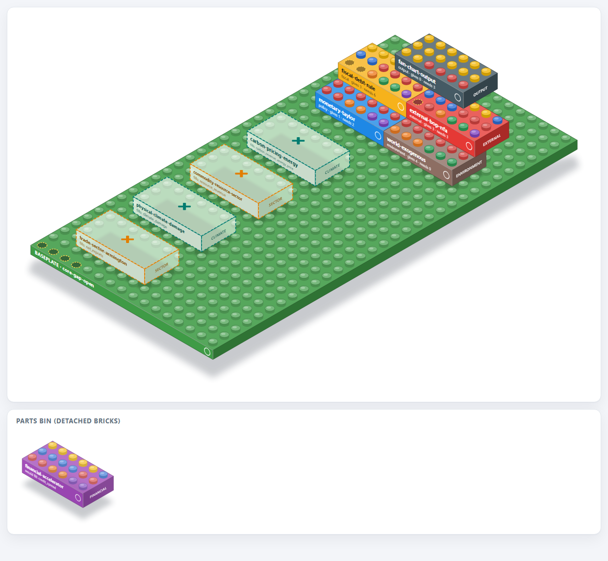
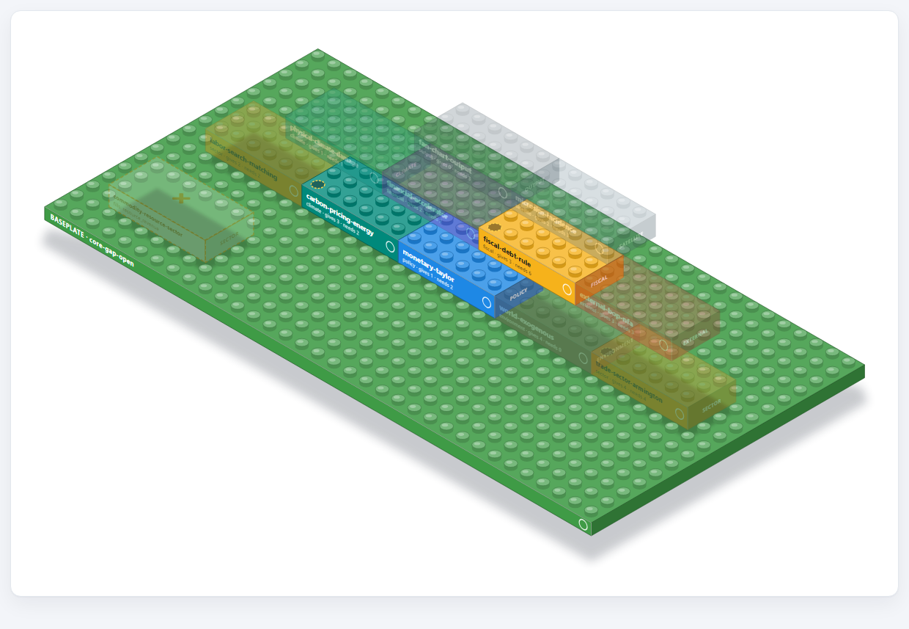

# Economic Modeling Studio

**Version 1.4.2**

A studio for building, estimating, validating and using economic models. **119 specialist agents** and **85 skills** (workflow commands such as `/build-dsge` or `/validate-model`) cover specification, building, estimation and independent validation for semi-structural projection and DSGE, input-output and CGE, trade and climate-economy models, deep learning, reinforcement learning, neural-network solvers, LLM-based tools, agent-based and game-theoretic models, and other econometric models. The studio also lets you work with every model as a **lego set**: a core model with plug-and-play components that can be added, swapped or removed, with explicit interfaces and the impact of every change checked first. It works with any coding agent that reads `AGENTS.md`: Claude Code, Codex, Cursor, Grok Build, Gemini CLI and others.

Two design choices set it apart.

**Models are assembled from components with explicit interfaces.** Each model has a manifest that lists its core block, the components attached to it, and every variable exchanged between them, with its unit and its timing (same period or lagged). The studio derives the rest from the manifest:
- the dependency graph, the simultaneous blocks and the solve order
- open inputs, and the documented closure each one runs on (for example "exports follow an exogenous baseline path")
- the accounting identities the assembled model must satisfy
- the bridges needed between components on different frequencies

The diagram of the model is generated from the same manifest, so the documented structure cannot drift from the model. This is the lego view: the core is the baseplate and each component is a brick.

**Changes are analyzed before they are made.** Adding, removing or replacing a component (a trade block, a fiscal rule, an alternative monetary reaction function) first produces a change-impact report. It shows the new linkages, inputs that become endogenous or exogenous, any new simultaneity, and which components need revalidation. Nothing is written until the modeler approves. A neutral-attachment test then confirms that the new component, set to neutral values, reproduces the existing baseline.

Around this sits a governed workflow, scaled to the model's size and risk level: specification, calibration or estimation, benchmark comparison, independent validation, phase gates and replication packages. The modeler sets the specification and makes every economic judgment. Missing data or evidence is reported as `NOT ASSESSED — NO DATA`, never filled in.


*Lego view generated from a model manifest by `/lego-show`, built as a stepped pyramid with `lego.py arrange`. Baseplate: the core model. Bricks: components, colored by type; each step rests on the bricks whose outputs it reads, with no limit on the number of levels. Dashed sockets: inputs running on documented closures. Dashed bricks: catalog components that would supply them. Badges: validation status.*

> The repository contains the studio (agents, commands, rules, templates and guardrails), not a library of finished models. Models are built in your own copy.

## How it works
1. **You state a question or a task.** For example: "what would a 10% tariff on imports from X do to the economy of country Y?", "build a small open-economy DSGE", "run this quarter's forecast round".
2. **A command runs the workflow.** Each command (for example `/build-cge`) names a primary agent and the specialists who join it. They work in parallel where possible.
3. **You stay in control.** Agents ask clarifying questions, present two to four options with trade-offs and a simple benchmark, draft section by section, and ask before writing files.
4. **Gates check the work.** Each stage has written exit criteria, and independent validation is separate from building.

The lifecycle is **Concept → Design → Build → Estimate → Validate → Release / Operate**. Small models move through it in days with light checks. Large ones add architecture decisions, staged integration and periodic revalidation.

## Typical uses

| Task | Commands | What you get |
|---|---|---|
| Specify and build a new model | `/scope-question`, `/model-spec`, then the build command for the family (e.g. `/build-semi-structural`, `/build-cge`) | A specification with a simple benchmark, then code, tests (steady state, identities, impulse-response signs) and the manifest |
| Bring in an existing model | `/adopt`, `/lego-map` | An inventory, reverse-documented equations and parameters, baseline outputs captured before any change, and a proposed decomposition into components for your approval |
| Extend or modify a model | `/lego-add`, `/lego-swap`, `/lego-detach` | A change-impact report first (example below), then the change, with neighbouring components flagged for revalidation |
| Review structure | `/lego-show`, `/lego-check` | 3D HTML view, text or Mermaid diagram; wiring, closure and identity checks |
| Validate and release | `/validate-model`, `/gate-check`, `/model-release` | Independent validation with a rating, gate verdicts with evidence, release package |

**Example: change-impact report.** Attaching a fiscal block with a debt-feedback rule to a small open-economy gap model (output of `python tools/lego.py attach`, before approval):

```
PLAN: attach fiscal-debt-rule
New joints:
  + core-gap-open --gdp_growth--> fiscal-debt-rule
  + core-gap-open --inflation_cpi--> fiscal-debt-rule
  + core-gap-open --output_gap--> fiscal-debt-rule
  + fiscal-debt-rule --fiscal_impulse--> core-gap-open
  + monetary-taylor --policy_rate--> fiscal-debt-rule
Stubs retired (these inputs become endogenous):
  + core-gap-open.fiscal_impulse  (was: zero fiscal impulse)
Stubs activated (these inputs become exogenous):
  ! fiscal-debt-rule.carbon_revenue  -> zero carbon revenue
  ! fiscal-debt-rule.resource_revenue  -> zero resource revenue
Neighbouring bricks to re-validate (marked stale if they were validated): core-gap-open, monetary-taylor

(dry run: nothing written. Re-run with --apply to make the change.)
```

**Scope of the structural checks.** The manifest checks verify consistency: units, timing, missing or duplicate providers, closures, identities and frequency bridges. Whether a component is economically sound remains a matter for calibration, estimation and independent validation, and the studio keeps those steps separate from building.

## Works with your coding agent

The studio is not tied to one assistant. Instructions, commands and rules are plain Markdown kept in one place, and each tool gets them in the form it reads natively.

| Tool | Project instructions | Workflow commands | Rules | Guardrails |
|---|---|---|---|---|
| Claude Code | `CLAUDE.md` (imports `AGENTS.md`) | `.claude/skills/`, invoked as `/start` etc.; specialists run as subagents | `.claude/rules/` | hooks in `.claude/settings.json`; git guard |
| Codex | `AGENTS.md` | `.agents/skills/`, invoked as `$start` etc. | rules table in `AGENTS.md` | git guard |
| Cursor | `AGENTS.md` | `.agents/skills/` (also reads `.claude/skills/`), invoked as `/start` etc. | `.cursor/rules/*.mdc` | hooks in `.cursor/hooks.json`; git guard |
| Grok Build | `AGENTS.md` | `.grok/skills/`, invoked as `/start` etc. | rules table in `AGENTS.md` | git guard |
| Gemini CLI / Antigravity | `GEMINI.md` (imports `AGENTS.md`) | `.agents/skills/` | rules table in `AGENTS.md` | git guard |
| Other agents (GitHub Copilot, Windsurf, Aider, ...) | `AGENTS.md` | `.agents/skills/` where Agent Skills are supported; otherwise the agent reads `.claude/skills/<name>/SKILL.md` | rules table in `AGENTS.md` | git guard |

- **One source.** Commands and rules are edited in `.claude/`. `python tools/sync_agents.py` writes the copies in `.agents/`, `.grok/` and `.cursor/rules/` and the rules table in `AGENTS.md`, removing the Claude-only placeholders. The integrity check fails if a copy is out of date.
- **Specialists everywhere.** Each command names the specialist agents it needs, and each specialist is a file in `.claude/agents/`. Tools with subagents run them as subagents; others read the file and apply it.
- **Guardrails everywhere.** The guard scripts (destructive commands, restricted data, secrets, immutable raw data) run as hooks in Claude Code and Cursor. For every tool, the git pre-commit guard stops restricted data, raw data and secrets from being committed: enable it with `git config core.hooksPath .githooks`.

Tool conventions change quickly. If a tool moves its folders, update `tools/sync_agents.py` and regenerate.

## Contents
- [How it works](#how-it-works) · [Typical uses](#typical-uses) · [Works with your coding agent](#works-with-your-coding-agent) · [What it covers](#what-it-covers) · [Models as lego sets](#models-as-lego-sets) · [Quick start](#quick-start) · [Commands](#commands) · [Typical workflows](#typical-workflows)
- [Quality controls](#quality-controls) · [The agents](#the-agents) · [Repository layout](#repository-layout) · [Setup](#setup)
- [Intended use: public data only](#intended-use-public-data-only) · [Limitations](#limitations) · [Customizing](#customizing) · [Version history](#version-history)

## What it covers

| Model family | Methods and models |
|---|---|
| **Macro projection and policy models** | Semi-structural gap models, FPAS, financial programming, revised minimum standard / three-gap models, stock-flow consistent models, large macroeconometric models |
| **Structural macro** | Small open-economy, multi-country, financial-friction, HANK and EMDE/LIC DSGE models; ZLB and occasionally binding constraints; perturbation, global and neural solution methods; Bayesian and simulation-based estimation; optimal policy and robust control |
| **Econometrics and time series** | VAR/SVAR/VECM, Bayesian VAR, local projections, dynamic factor models and nowcasting, state-space and unobserved-components models, time-varying parameters and regime switching, panel and causal inference, shock identification |
| **Input-output, SAM and CGE** | Input-output and supply-use tables, SAMs, multipliers and linkages, multi-regional and environmentally extended IO, static and recursive-dynamic CGE (single- and multi-region), regional and spatial models, production networks and supply-chain shocks |
| **Trade** | Gravity and structural gravity, quantitative trade general equilibrium, global value chains, tariff and non-tariff-measure counterfactuals, trade agreements, border adjustments |
| **Climate, energy and resources** | Climate-macro and integrated-assessment-style models, carbon pricing and border adjustment, transition and physical risk, energy systems, commodity markets, resource-rich economies, agriculture and food security |
| **Fiscal and public finance** | Debt sustainability, fiscal multipliers, tax-benefit microsimulation, revenue forecasting, public investment, fiscal risks |
| **Monetary and financial** | Policy rules, unconventional policy, inflation and expectations, yield curves, banks and credit, macroprudential policy, stress testing, capital flows, digital money |
| **External sector** | Balance of payments and international investment position, external assessments, global spillovers |
| **Open-economy policy mix** | Joint use of monetary policy, FX intervention, capital flow measures, macroprudential and fiscal policy by shock and friction; microfounded models with occasionally binding external constraints; application to low-income countries |
| **Growth, labor, distribution, development** | Growth and productivity, labor and demography, inequality and incidence, fragility and disasters, AI and the digital economy |
| **AI and machine learning** | Deep-learning and foundation-model forecasters, deep reinforcement learning for policy, neural solvers, simulation-based inference, causal ML, graph methods, generative scenarios, interpretability; LLM tools (extraction, retrieval, agents, modeling copilot) |
| **Games, agents, strategy** | Game theory, mechanism design, policy-interaction and sovereign-crisis games, agent-based models, wargames |
| **Cross-cutting support** | Data and statistics (national accounts, surveys, high-frequency data, quality), computation (Dynare/MATLAB, Python, Julia, GAMS, HPC/GPU, MLOps, symbolic derivation), validation, risk and ethics, and communication |

Models are classed **small, medium or large**, and effort scales with class (see [model classes](.claude/docs/model-classes.md)). A decision table there maps common questions to the right model family.

## Models as lego sets
Any model can be represented as a set of bricks, so you can see what it is made of and change it without rebuilding it.

- The **baseplate** is the core model (for example a gap model or a DSGE).
- A **brick** is a component: a trade sector, a fiscal block, a financial accelerator, a carbon-pricing block, a CGE, a household microsimulation, a fan-chart tool.
- **Studs** are the variables a brick provides and needs, each with a unit and a timing (same period or lagged).
- A needed variable that nothing provides is an **open stud**. The model keeps running on a documented **stub** (for example "exports follow an exogenous baseline path"), so a model without a trade sector still works.

| You want to | Command |
|---|---|
| Turn a new or existing model into a lego set | `/lego-map` |
| See the set (3D picture, text or diagram), its open studs and suggested bricks | `/lego-show` |
| Add a brick that is missing, for example trade | `/lego-add` |
| Take a brick off (it goes to a parts bin, and its stub takes over) | `/lego-detach` |
| Swap a brick for an alternative, for example one monetary rule for another | `/lego-swap` |
| Check that everything fits | `/lego-check` |
| Build the picture as a stepped pyramid (positions only, never wiring) | `python tools/lego.py arrange` |
| Record a brick's validation result (with the report as evidence) | `python tools/lego.py validate` |
| Create a brick that is not in the catalog | `/lego-brick` |

Every change is shown as a **plan first**: new joints, inputs that become endogenous or exogenous, new simultaneous blocks, frequency mismatches, conflicts, and which neighbouring bricks must be re-validated. Nothing is written until you approve. The tool checks the wiring (units, timing, duplicate providers, accounting identities, bridges between frequencies); whether a brick is *economically* right stays with calibration and validation, including a neutral-attachment test (a new brick set to neutral values must reproduce the old baseline).

See the [guide](docs/lego.md) and two worked examples (open the HTML files in a browser): [a six-brick set with one brick in the parts bin](lego/examples/small-open-economy.html) and [the full twelve-brick set](lego/examples/small-open-economy-full.html). The engine is `python tools/lego.py` (standard library only).

**Building up.** Bricks stack vertically with no limit on the number of levels: a brick stands on the bricks whose outputs it reads. In the default grid the stacks stand side by side; `python tools/lego.py arrange <manifest> --apply` builds the whole set into a stepped pyramid. Positions are stored in the manifest, so any brick can be moved by hand, and they never change the wiring.

**A starter set.** The core with five bricks, built as a small two-step pyramid. Dashed yellow sockets on the baseplate and on bricks are open studs running on stubs; the dashed ghost bricks in the front yard are catalog bricks that would fill them (trade, carbon pricing, physical climate damage, resource revenue). A detached brick waits in the parts bin and says which open stud it would fill.



**Hover to see the wiring.** Hovering a brick fades everything it is not connected to. Here the fiscal rule is highlighted together with the core it feeds, the monetary rule it reads and the carbon-pricing block whose revenue it receives.



## Quick start
1. Open this folder in your coding agent (from the project root or any subfolder), and run `git config core.hooksPath .githooks` once to enable the commit guard.
2. Type `/start` (`$start` in Codex) and describe what you want to do. Alternatives: `/help` for what exists, `/project-stage-detect` to see where a project stands, `/adopt <path>` to bring in an existing model.
3. Follow the suggested next command. A typical first step is `/scope-question`, then `/select-model-class`.

## Commands
Full list: [docs/skill-catalog.md](docs/skill-catalog.md).

| Stage | Commands |
|---|---|
| Onboarding | `/start` `/help` `/project-stage-detect` `/setup-environment` `/adopt` `/settings` |
| Scoping and design | `/scope-question` `/select-model-class` `/model-brief` `/literature-review` `/model-spec` `/calibration-plan` `/data-requirements` `/quick-model` |
| Build: macro and structural | `/build-semi-structural` `/build-fpas` `/build-financial-programming` `/build-dsge` `/build-hank` `/build-multicountry` `/build-sfc` |
| Build: sectoral, trade, climate | `/build-io-sam` `/build-cge` `/build-trade-model` `/build-climate-macro` |
| Build: strategic and agent-based | `/build-game-model` `/build-abm` |
| Build: AI | `/build-deep-forecaster` `/build-drl-policy` `/build-neural-solver` `/build-llm-pipeline` `/build-llm-agents` `/build-rag-kb` `/build-causal-ml` |
| Estimation | `/estimate-var` `/estimate-bvar` `/estimate-dsge` `/calibrate-model` `/nowcast` `/local-projections` `/identify-shocks` |
| Analysis | `/forecast-round` `/scenario-analysis` `/policy-simulation` `/fan-chart` `/debt-sustainability` `/stress-test` `/spillover-analysis` `/external-assessment` `/distributional-analysis` |
| Analysis: sectoral, trade, climate | `/trade-policy-analysis` `/supply-chain-shock` `/carbon-pricing-analysis` `/climate-scenario` |
| Validation and QA | `/validate-model` `/backtest` `/sensitivity-analysis` `/robustness-check` `/replicate` `/code-review` `/ai-audit` `/model-risk-review` |
| Documentation | `/model-card` `/technical-note` `/policy-brief` `/chart-pack` |
| Governance | `/gate-check` `/milestone-review` `/retrospective` `/model-release` |
| Multi-agent teams | `/team-dsge` `/team-forecast` `/team-stress-test` `/team-ai-model` `/team-fiscal` `/team-country-analysis` |
| Modular (lego) models | `/lego-map` `/lego-show` `/lego-add` `/lego-detach` `/lego-swap` `/lego-check` `/lego-brick` |
| Capacity building | `/design-training` `/create-exercise` |

## Typical workflows
- **Quick, small model:** `/scope-question` → `/quick-model` → `/validate-model` → `/model-card`
- **Structural model:** `/select-model-class` → `/model-brief` → `/model-spec` → `/data-requirements` → `/calibration-plan` → `/team-dsge` → `/estimate-dsge` → `/validate-model` → `/model-release`
- **Sectoral or trade analysis:** `/build-io-sam` → `/build-cge` (or `/build-trade-model`) → `/trade-policy-analysis` or `/carbon-pricing-analysis` → `/robustness-check` → `/policy-brief`
- **Forecast round:** `/nowcast` → `/team-forecast` → `/fan-chart` → `/policy-brief` → `/retrospective`
- **Climate-economy analysis:** `/build-climate-macro` → `/climate-scenario` → `/carbon-pricing-analysis` → `/distributional-analysis`
- **AI model:** `/select-model-class` → `/team-ai-model` (benchmark first) → `/ai-audit` → `/model-risk-review` → `/model-release`
- **Existing model:** `/adopt <path>` → `/lego-map` → `/validate-model` → `/model-card`
- **Modular model:** `/lego-map` → `/lego-show` → `/lego-add` (for example the missing trade sector) → neutral-attachment test → `/lego-check` → `/validate-model`

## Quality controls
- **You decide.** Agents advise; nothing is written without your approval.
- **Independent validation.** The agents or people who build a model do not validate it. Validation covers conceptual soundness, independent re-implementation of core outputs, benchmarks, sensitivity and stress cases, with a rating of PASS, PASS WITH CONDITIONS, FAIL or NOT ASSESSED.
- **No fabrication.** Missing data, code or results yield `NOT ASSESSED — NO DATA` rather than invented numbers or citations.
- **Benchmark first.** Complex and AI models are compared with a simple transparent benchmark on the same data and split.
- **Uncertainty is part of the result.** Forecasts, scenarios and estimates carry ranges and stated assumptions. Elasticities, closures and damage functions are varied, not assumed.
- **Model-specific checks.** Accounting identities and steady-state residuals for DSGE and macro models; balance and benchmark-replication tests for IO, SAM and CGE models; determinacy and accuracy diagnostics for solutions; look-ahead and leakage checks for forecasting and AI.
- **Reproducibility.** Seeds, software versions, data vintages and a one-command replication path for released results.
- **Modular integrity.** For lego models: every exchanged variable is declared with a unit and timing, every input has a source or a documented stub, bricks on a different frequency need a bridge, and a brick changed since validation is marked stale until it is re-validated.
- **Data protection.** Data classification levels, protected folders, command guards and a ban on restricted data in prompts.

## The agents
119 agents, grouped by area of expertise. They are peers: none manages another. Each lists the specialists it works most closely with, and five cross-cutting functions (economic reasoning, methodology, model-risk governance, policy relevance, project planning) are available for consultation by all. See [coordination rules](.claude/docs/coordination-rules.md) and the full [roster](docs/agent-roster.md).

| Area of expertise | Agents | Examples |
|---|---|---|
| Framing, methods and governance | 5 | economic reasoning, modeling methodology, model-risk governance |
| Macro models: small, medium, traditional | 6 | semi-structural gap, FPAS, financial programming, three-gap, SFC, macroeconometric |
| Structural macro | 10 | open-economy DSGE, multi-country, financial frictions, HANK, perturbation and global solution, Bayesian estimation, ZLB, optimal policy |
| Econometrics and time series | 8 | VAR/VECM, BVAR, DFM nowcasting, local projections, state space, panel and causal inference |
| Forecasting and scenarios | 3 | forecast evaluation, forecast combination, scenario and risk analysis |
| Input-output, CGE, trade and sectoral | 7 | input-output and SAM, CGE, trade policy simulation, trade and GVC, production networks, regional and spatial, agriculture and food |
| Climate, energy and natural resources | 6 | climate-macro, carbon pricing, physical climate risk, energy transition, commodities, resource-rich economies |
| Fiscal and public finance | 6 | debt sustainability, multipliers, tax-benefit microsimulation, revenue and tax policy, public investment, fiscal risk |
| Monetary and financial | 9 | policy rules, unconventional policy, inflation, expectations, yield curve, banks and credit, macroprudential, stress testing, digital money |
| External sector and global linkages | 4 | balance of payments, external assessment, capital flows, spillovers |
| Open-economy policy mix | 4 | policy mix by shock and friction, external frictions and FX intervention, microfounded policy-mix model, low-income countries |
| Growth, labor, distribution, development | 5 | growth and productivity, labor and demography, inequality, fragility and disasters, AI and the digital economy |
| AI and machine learning | 16 | deep learning, time-series deep learning, deep RL, neural solvers, simulation-based inference, LLM analysis and agents, RAG, causal ML, graph ML, interpretability |
| Games, agents and strategic behavior | 6 | game theory, mechanism design, agent-based models, policy-interaction and sovereign-crisis games, wargames |
| Data and statistics | 6 | data pipelines, national accounts, survey microdata, high-frequency data, data quality, governance |
| Computation and engineering | 7 | Dynare/MATLAB, Python/Julia, HPC/GPU, MLOps, numerical methods, reproducibility, symbolic derivation |
| Validation, risk and ethics | 6 | model validation, backtesting, sensitivity, replication audit, AI ethics, LLM red-teaming |
| Communication and capacity building | 5 | policy briefs, technical documentation, visualization, stakeholder liaison, training design |

## Repository layout
```
AGENTS.md                  project instructions for every coding agent (CLAUDE.md and GEMINI.md import it)
studio-config.yaml         rigor by model class, data classes, approved toolchains, AI governance
.claude/agents/            119 agent definitions
.claude/skills/            85 commands (one SKILL.md each)
.claude/rules/             path-scoped standards (models, DSGE, sectoral/trade/climate, econometrics, lego manifests, AI/ML, RL, LLM, data, forecasts, validation, ...)
.claude/hooks/             Python guard scripts: session context, command guard, protected paths, document checks, audit log
.agents/ .grok/ .cursor/   generated copies of commands and rules for other coding agents; Cursor hooks
.githooks/                 git pre-commit guard (any tool)
.claude/docs/              collaboration protocol, coordination, phase gates, risk levels, model classes, confidentiality and AI use
docs/                      templates (22), lego guide, screenshots (docs/images), agent roster, command catalog; briefs, models, notes, references, training
lego/                      brick catalog (20 reusable bricks), shared port definitions, two worked examples
models/                    model code by family: semi-structural, fpas, financial-programming, dsge, multicountry,
                           io-sam, cge, trade, climate, sfc, abm, games, ai, llm, econometrics
                           (each model with its model.lego.json; estimation-only econometric models need none)
data/ forecasts/ validation/ production/ tests/ notebooks/ scripts/    working folders
tools/lego.py              lego engine: catalog, new, show, check, attach, detach, swap
tools/lego_view.py         isometric 3D picture of a lego set (self-contained HTML)
tools/validate_studio.py   integrity check (counts, references, hooks, settings, lego catalog and examples)
tools/test_studio.py       tests for hooks, guards, lego engine, agent adapters and documentation consistency
tools/sync_agents.py       regenerates the copies for other coding agents from .claude/
tools/precommit_guard.py   git pre-commit guard for restricted data, raw data and secrets
```

## Setup
- A coding agent (Claude Code, Codex, Cursor, Grok Build, Gemini CLI or another that reads `AGENTS.md`), and Python 3.9 or later (hooks and tools use only the standard library).
- Your modeling software as needed (Dynare/MATLAB, Julia, Python, R, GAMS), configured in `studio-config.yaml`; `/setup-environment` can guide this.
- Verify the install: `python tools/validate_studio.py` (integrity) and `python tools/test_studio.py` (hooks and consistency).
- Enable the commit guard once per clone: `git config core.hooksPath .githooks`.
- Start your agent from the project folder or any subfolder; the hooks find the project root automatically. If a hook script is missing, it does nothing rather than blocking your session.

## Intended use: public data only
This studio is a **template**, not an official product of any institution. It is intended for work with **public data** (published statistics, open datasets, published literature) and for development, learning and prototyping.

**Internal, restricted or confidential data.** If you want to use the studio with non-public data, you **MUST** first comply with your organization's IT policies and data-governance guidelines. That includes:
- **Where it may run:** only on approved machines, networks and environments, whether a managed workstation, a secure server or an approved cloud tenant.
- **How it may be run:** only with approved tools, AI services and models, and with the access controls, logging and retention rules your organization requires.
- **What may leave the environment:** nothing sensitive goes to external services, prompts or logs unless your organization explicitly authorizes it.
- **Review and sign-off:** involve your IT security, data-governance and model-risk functions before you start.

Adapt `studio-config.yaml` and `.claude/docs/confidentiality-and-ai-use.md` to those rules before adding any non-public data. The hooks and permissions here are safeguards against mistakes, not a substitute for policy, and they do not make a non-compliant setup compliant. When in doubt, use public or synthetic data only.

## Limitations
- The agents are expert instructions for an AI assistant, not authorities. Their outputs (equations, code, parameter sources, literature, numbers) are claims to be checked, and the studio's process is built around checking them.
- The agent descriptions of competencies and quality gates summarize standard practice. Have practitioners in your field review them before relying on them.
- Generated models are only as good as the data, specification and validation behind them. The studio does not replace subject-matter judgment or country knowledge.
- Commands that use several specialists work best in tools that run subagents. Elsewhere the agent applies each specialist's instructions in turn, which is slower. In Claude Code they use the `Task` tool; if your version names it differently (for example `Agent`), adjust the `allowed-tools` line in `.claude/skills/*/SKILL.md`.
- Automatic hooks run in Claude Code and Cursor only. In other tools the rules still apply and the git guard still blocks risky commits, but commands are not checked before they run. The hooks call `python`; where only `python3` exists (common on macOS), add a `python` alias or the hooks do nothing.
- Cursor reads commands from both `.agents/skills/` and `.claude/skills/`, so it may list each command twice. The two copies have the same instructions.

## Customizing
Agents and skills are Markdown files with YAML frontmatter; edit them freely. After changes run `python tools/validate_studio.py`. To add an agent, create `.claude/agents/<name>.md` and list it as a peer in the related agents. To add a command, create `.claude/skills/<name>/SKILL.md`. Path-scoped standards live in `.claude/rules/`. After changing commands or rules, run `python tools/sync_agents.py` to update the copies for other coding agents.

## Version history
- **1.4.2** — Improved agents and skills: fuller, more professional guidance written from a modeler's perspective, with lego engine workflows unchanged.
- **1.4.1** — Completes 1.4.0: `check` warns when hand-placed bricks overlap or float; a naming fix for the capital-flows specialist; `lego.py arrange` documented in `/lego-show` and the lego rule.
- **1.4.0** — Open-economy policy mix: four agents (framework, external frictions, microfounded model, low-income countries) and three bricks (FX intervention, capital flow measures, macroprudential policy). Lego view: vertical stacking with no limit on levels; `lego.py arrange` builds a set into a stepped pyramid with positions stored in the manifest; `lego.py validate` records validation results with evidence; identities come with their bricks; parts-bin suggestions; clearer change plans. Cursor guards answer in JSON; git guard finds a working Python. New README pictures.
- **1.3.0** — Works with any coding agent: `AGENTS.md` as the shared instructions (imported by `CLAUDE.md` and `GEMINI.md`); command and rule copies for Codex, Cursor, Grok Build and Gemini generated from `.claude/` by `tools/sync_agents.py`; Cursor hooks; a git pre-commit guard for every tool. Raw data protected from shell edits as well as file edits. `models/econometrics/` with its own rules. README rewritten for practitioners.
- **1.2.0** — Models as lego sets: `/lego-map`, `/lego-show`, `/lego-add`, `/lego-detach`, `/lego-swap`, `/lego-check`, `/lego-brick`; `tools/lego.py` engine (plans before changes, stubs, slots, simultaneity and solve order, identities, frequency bridges, stale-brick tracking, isometric 3D picture); catalog of 16 bricks and shared port definitions; every `/build-*` command now registers a lego manifest.
- **1.1.0** — Agents reorganized by area of expertise (no hierarchy); added input-output/SAM, CGE, quantitative trade, production-network, regional/spatial, agriculture, carbon-pricing, physical-climate-risk, resource-economy, optimal-policy, banking, expectations, tax-revenue, survey-microdata and symbolic-derivation specialists; added build-io-sam, build-cge, build-trade-model, build-climate-macro, carbon-pricing-analysis, trade-policy-analysis and supply-chain-shock commands; README rewritten.
- **1.0.0** — Initial release: 115 agents, 72 commands, hooks, rules and templates.

## License
MIT. See [LICENSE](LICENSE).
